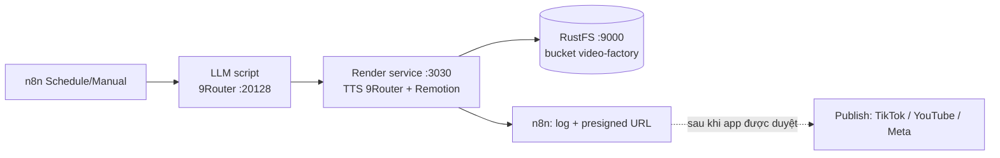

# Video Factory — Plan

Tạo video ngắn dọc (1080×1920) tự động bằng n8n, chạy 100% local trên Mac.
Khi lên hosting chỉ đổi cấu hình (endpoint, URL), không đổi code.

## Kiến trúc



| Thành phần | Local (bây giờ) | Hosting (sau) | Đổi gì |
|---|---|---|---|
| Điều phối | n8n `:5678`, SQLite `~/.n8n` | n8n Docker/VPS + Postgres | export/import workflow + credentials |
| LLM | 9Router `localhost:20128/v1` | 9Router trên VPS hoặc OpenRouter | `url` trong credential `9Router` |
| TTS | 9Router `edge-tts/vi-VN-HoaiMyNeural` (free) | giữ nguyên hoặc ElevenLabs qua 9Router | `TTS_MODEL` |
| Render | `render/` Remotion + Express, launchd | container `render/` hoặc Remotion Lambda | `RENDER_URL` |
| Lưu trữ | RustFS `:9000` (Docker) | Cloudflare R2 | `S3_ENDPOINT`, key; credential S3 trong n8n |
| Backup | `backup.sh` + launchd 03:00 hằng ngày | `rclone sync` lên R2 | `BACKUP_DIR` hoặc thêm rclone |

## Quyết định

- **RustFS thay MinIO/SeaweedFS**: Apache-2.0, ~350 MB RAM, ghi file lớn nhanh, API S3 → chuyển sang R2 chỉ đổi endpoint.
- **Caption từng từ theo ước lượng**: STT của 9Router (`cx/transcribe`) không trả timestamp. Mỗi câu có một file TTS riêng, độ dài lấy bằng `ffprobe`. Thời điểm từng từ được chia theo số ký tự trong `mp3Sec`, và từ đang đọc được tô `#ffd166`.
  Nâng cấp khi câu dài bị lệch: lấy `WordBoundary` từ edge-tts hoặc thêm whisper.cpp.
- **Render service tự upload lên S3**: n8n chỉ gửi JSON và nhận lại key/URL. Không đẩy video nhị phân qua bộ nhớ n8n.
- **Không dùng `N8N_DEFAULT_BINARY_DATA_MODE=s3`**: cần license trả phí. Dùng node S3 + credential RustFS.
- **Publish để sau**: TikTok Content Posting API cần app được audit (nếu chưa thì chỉ đăng `SELF_ONLY`). YouTube cần OAuth app. Workflow publish được tạo nhưng tắt cho đến khi có credential.
- **Execute Command bị tắt mặc định** (`NODES_EXCLUDE`): pipeline không dùng node này. Chỉ workflow đăng nhập TikTok cũ cần nó.

## API render service

`POST http://localhost:3030/render`

Nhận `narration.json` (từ `docs/flows/flows.json`, `docs/soul/thresholds.json`) hoặc legacy `{ title, sentences }`:

```json
{ "title": "Tiêu đề", "flow": "A", "outroHold": 3, "facts": [{"id": "f1", "claim": "...", "source": "https://..."}], "scenes": [{"id": "hook", "lines": [{"text": "...", "fact": "f1"}]}], "voice": "edge-tts/vi-VN-HoaiMyNeural" }
```

→ `{ "id": "<id>", "key": "videos/<id>.mp4", "url": "<presigned 7 ngày>", "out": "out/<id>/", "durationSec": 21.4, "lint": { "errors": [], "warnings": [] }, "publishable": false }`

`POST http://localhost:3030/lint` → chạy `render/lint.js` không render. `GET /health` → `{ ok: true }`

## Core concepts (áp dụng từ `howznguyen/shorts-kit`)

- **SOUL & Thresholds** (`docs/soul/SOUL.md`, `docs/soul/thresholds.json`, `render/lint.js`): Facts before words, không bịa số liệu, kết bằng cú lật (turn + share line + `outroHold` 3–4s, không logo outro), câu ≤ 25 từ, safe-zone `[212, 1726]` / panel `774px`, kiểm tra từ/ký tự cấm tiếng Việt & tiếng Anh.
- **Facts ledger** (`docs/facts/facts.json`, `docs/facts/sources.json`): nơi lưu claim đã verify và nguồn gốc.
- **20 flows & shot grammar** (`docs/flows/flows.json`, `docs/flows/A`–`T`, `docs/shots/`): beat order chuẩn cho từng dạng video + từ điển cảnh quay.
- **Audio & Video mastering** (`render/server.js`): 1-pass `ffmpeg` chuẩn hóa `-13 LUFS`, true peak `≤ -1 dB`, `48 kHz`, `libx264` `yuv420p` `bt709` `+faststart`.
- **Hand-off & Publish gate**: luôn xuất gói `out/<id>/` (`<id>-upload.mp4`, `cover.png`, `cover-thumbtest.png`, `caption.txt`, `pinned-comment.txt`, `narration.json`, `lint.json`, `qa/qc.json`). `publishable` chỉ `true` khi không có lỗi lint, QC pass, và `AUTO_PUBLISH=true` (mặc định `false`).

## Workflow n8n

1. **VF – Generate video**: Manual + Schedule (09:00 hằng ngày) → *Topic* (Set) → *Write script* (HTTP Request tới 9Router chat/completions, ra JSON `{title, sentences[]}`) → *Parse* (Code) → *Render* (HTTP Request `:3030/render`, timeout 10 phút) → *Download video* → *QC video* (POST `:3030/qc`) → *Result* → *Publishable?* (QC) → *Publish TikTok*.
2. **VF – Publish** (tắt): nhận `key`, `url` → TikTok init `PULL_FROM_URL` / YouTube upload. Bật khi app được duyệt. URL phải truy cập được từ internet (R2 public hoặc tunnel), RustFS local thì không.

## Vận hành

| Việc | Lệnh |
|---|---|
| Bật storage | `docker compose up -d` |
| Bật render | `cp launchd/*.plist ~/Library/LaunchAgents/ && launchctl load ~/Library/LaunchAgents/vn.videofactory.render.plist` (tự chạy khi đăng nhập; log `/tmp/vf-render.*.log`) |
| Backup tay | `./backup.sh [đích]` |
| Restore | xem mục dưới |
| Test render | `./render/smoke.sh` |

### Restore

```bash
B=~/video-factory-backups/<timestamp>
# dừng n8n trước
cp $B/n8n.sqlite ~/.n8n/database.sqlite && cp $B/n8n-config ~/.n8n/config
docker compose down && rsync -a --delete $B/s3/ data/s3/ && docker compose up -d
cp $B/.env .env
```

## Lên hosting (checklist)

1. Tạo bucket R2 → `rclone sync data/s3/video-factory r2:video-factory`.
2. Sửa credential `RustFS (local S3)` trong n8n: endpoint R2, key R2. Sửa `.env` render: `S3_ENDPOINT`, `S3_ACCESS_KEY`, `S3_SECRET_KEY`.
3. Build `render/` thành container (Node 22 + Chrome headless shell) hoặc chuyển sang Remotion Lambda.
4. n8n: `export:workflow --all` + `export:credentials --all --decrypted` → import trên server (giữ `N8N_ENCRYPTION_KEY` cũ thì không cần decrypt).

## Trạng thái

- [x] RustFS + bucket + credential n8n
- [x] 9Router: LLM, TTS đã kiểm tra
- [x] backup.sh
- [x] Render service + launchd (`render/smoke.sh` → SMOKE OK, 1080×1920 h264 + aac)
- [x] Backup launchd 03:00 (bản sao plist trong `launchd/`)
- [x] Workflow VF – Generate video `vfGenerateVideo01`: chạy thử OK, video 29,2 s trong ~29 s
- [x] Workflow VF – Publish `vfPublishTemplate01`: đã hỗ trợ TikTok Direct Post (`FILE_UPLOAD` qua sidecar nodejs `render/tiktok.js`, không cần public URL S3)
- [x] Áp dụng toàn bộ core concepts từ `howznguyen/shorts-kit` (`docs/soul`, `docs/flows`, `docs/shots`, `docs/facts`, `render/lint.js`, Remotion safe-zone/caption chunks, ffmpeg `-13 LUFS` + `bt709`, hand-off `out/<id>/`, cổng `Publishable?` trong `workflows/generate-video.json`; `render/smoke.sh` → SMOKE OK)
- [x] Import lại `workflows/generate-video.json` (đã có node *QC video*; runtime HyperFrames chọn qua `runtime` trong narration); n8n đang chạy (`vn.n8n.dev`)
- [x] **Topic từ content queue** (`content/queue.json`) thay vì hardcode — workflow lấy qua `GET /topic/next`, báo xong qua `POST /topic/done`. Thêm topic qua `POST /topic/add` hoặc tự động qua trend.
- [x] **Trend Intelligence + Learning Engine** — `GET /trends/refill` (Google Trends VN → 9Router → topic mới vào queue); `GET /analytics/learn` tổng hợp tín hiệu (retention/CTR/revenue) theo flow/runtime/profile dùng để ưu tiên topic kế tiếp. Dữ liệu ở `data/analytics.sqlite`, được backup kèm `backup.sh`.
- [x] **Multi-platform publish** — `POST /publish` nhận `platforms:[tiktok,youtube,meta]`. TikTok (Direct Post) đã chạy; YouTube (resumable upload) và Meta (Reels) viết đủ adapter — chỉ cần điền credential trong `.env` (xem `.env.example`). Meta cần `PUBLIC_VIDEO_BASE` (R2 public/tunnel).
- [ ] Bật Schedule (activate workflow `vfGenerateVideo01`) — workflow hiện đã có nhánh `Refill trends` trước `Next topic`; kích hoạt trong n8n khi muốn chạy hằng ngày 09:00.
